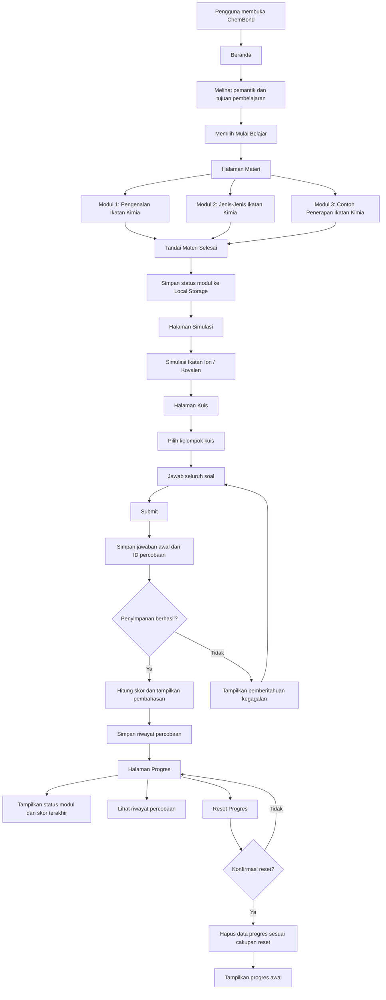

# USER_FLOW.md
# USER FLOW — CHEMBOND

## 1. Gambaran Umum

ChemBond merupakan website media pembelajaran interaktif Kimia untuk peserta didik SMA/MA kelas X dengan materi Ikatan Kimia.

Website dirancang untuk membantu pengguna memahami konsep ikatan kimia melalui materi, ilustrasi, simulasi interaktif, kuis, dan pemantauan progres belajar.

Pengguna dapat mengakses pembelajaran tanpa harus melakukan login. Progres belajar dan hasil kuis pada tahap MVP disimpan secara lokal menggunakan Local Storage.

ChemBond memiliki lima halaman utama:
1. Beranda
2. Materi
3. Simulasi
4. Kuis
5. Progres

Navigasi ant halaman dikelola menggunakan internal state (`useState`) pada komponen utama `App.tsx`.

---

## 2. Alur Inti Pengguna

1. Pengguna membuka website ChemBond dan masuk ke halaman Beranda.
2. Sistem menampilkan pemantik berupa fenomena kehidupan sehari-hari yang berkaitan dengan ikatan kimia.
3. Pengguna membaca pengantar dan tujuan pembelajaran.
4. Pengguna menekan tombol mulai belajar untuk membuka halaman Materi.
5. Pengguna memilih dan mempelajari tiga modul pembelajaran:
   - Modul 1: Pengenalan Ikatan Kimia.
   - Modul 2: Jenis-Jenis Ikatan Kimia.
   - Modul 3: Contoh Penerapan Ikatan Kimia.
6. Setelah mempelajari suatu modul, pengguna dapat menekan tombol "Tandai Materi Selesai" untuk mencatat penyelesaian modul tersebut.
7. Pengguna membuka halaman Simulasi untuk mengeksplorasi visualisasi pembentukan ikatan ion dan ikatan kovalen.
8. Pengguna membuka halaman Kuis dan memilih kelompok soal sesuai modul yang ingin dikerjakan.
9. Pengguna mengerjakan seluruh soal dan menekan tombol Submit.
10. Sistem menyimpan jawaban awal dan identitas percobaan sebelum menampilkan hasil.
11. Setelah penyimpanan berhasil, sistem menampilkan skor, kunci jawaban, dan pembahasan.
12. Pengguna membuka halaman Progres untuk melihat status penyelesaian materi serta hasil kuis.
13. Pengguna dapat mengulang kuis atau melakukan reset progres setelah memberikan konfirmasi.

---

## 3. Alur Setiap Halaman

### 3.1 Beranda (Home)

**Tujuan:** Memperkenalkan ChemBond dan menarik minat pengguna untuk mempelajari ikatan kimia.

Alur pengguna:
1. Pengguna membuka website ChemBond.
2. Sistem menampilkan navbar yang memuat menu Beranda, Materi, Simulasi, Kuis, dan Progres.
3. Sistem menampilkan hero section dengan judul utama "Mengungkap Rahasia Ikatan Antaratom".
4. Sistem menampilkan pemantik berupa fenomena kimia dalam kehidupan sehari-hari.
5. Pengguna membaca pengantar mengenai ikatan kimia.
6. Pengguna membaca tujuan pembelajaran.
7. Pengguna melihat gambaran singkat modul dan fitur pembelajaran.
8. Pengguna menekan tombol mulai belajar untuk menuju halaman Materi.

**Kondisi alternatif:**
- Jika pengguna memilih menu lain pada navbar, sistem berpindah ke halaman yang dipilih.
- Jika pengguna kembali ke Beranda, sistem menampilkan halaman utama tanpa menghapus progres yang sudah tersimpan.

### 3.2 Halaman Materi

**Tujuan:** Menyediakan materi pembelajaran Ikatan Kimia yang tersusun dalam tiga modul.

Halaman Materi menyediakan navigasi untuk memilih modul pembelajaran.

**Modul 1 – Pengenalan Ikatan Kimia**

Alur pengguna:
1. Pengguna membuka Modul 1.
2. Sistem menampilkan pengantar dan tujuan pembelajaran modul.
3. Pengguna mempelajari konsep dasar ikatan kimia.
4. Pengguna mempelajari kestabilan atom, konfigurasi elektron, dan elektron valensi.
5. Pengguna mempelajari aturan duplet dan oktet.
6. Pengguna mengamati ilustrasi pendukung materi.
7. Setelah selesai belajar, pengguna dapat menekan tombol "Tandai Materi Selesai".

**Modul 2 – Jenis-Jenis Ikatan Kimia**

Alur pengguna:
1. Pengguna membuka Modul 2.
2. Sistem menampilkan pengantar dan tujuan pembelajaran modul.
3. Pengguna mempelajari ikatan ion.
4. Pengguna mempelajari ikatan kovalen.
5. Pengguna mempelajari ikatan logam.
6. Pengguna mengamati proses pembentukan dan karakteristik masing-masing jenis ikatan.
7. Pengguna mengamati ilustrasi atau contoh senyawa yang relevan.
8. Setelah selesai belajar, pengguna dapat menekan tombol "Tandai Materi Selesai".

**Modul 3 – Contoh Penerapan Ikatan Kimia**

Alur pengguna:
1. Pengguna membuka Modul 3.
2. Sistem menampilkan pengantar dan tujuan pembelajaran modul.
3. Pengguna mempelajari contoh penerapan ikatan ion, kovalen, dan logam dalam kehidupan sehari-hari.
4. Pengguna mengidentifikasi hubungan jenis ikatan dengan karakteristik zat.
5. Pengguna mengamati gambar atau ilustrasi penerapan ikatan kimia.
6. Setelah selesai belajar, pengguna dapat menekan tombol "Tandai Materi Selesai".

**Aturan penyelesaian materi:**
- Setiap modul memiliki status penyelesaian masing-masing.
- Status awal setiap modul adalah "Belum Selesai".
- Modul hanya dinyatakan selesai setelah pengguna menekan tombol "Tandai Materi Selesai".
- Membuka atau membaca materi saja tidak otomatis mengubah status menjadi selesai.
- Setelah tombol ditekan, sistem menyimpan status penyelesaian modul ke Local Storage.
- Status selesai tetap tersimpan ketika pengguna berpindah halaman atau memuat ulang website.
- Penyelesaian satu modul tidak otomatis menyelesaikan modul lainnya.

### 3.3 Halaman Simulasi

**Tujuan:** Membantu pengguna memahami proses pembentukan ikatan kimia melalui visualisasi interaktif.

Alur pengguna:
1. Pengguna membuka halaman Simulasi melalui navbar.
2. Sistem menampilkan pilihan simulasi yang tersedia.
3. Pengguna memilih simulasi ikatan ion atau visualisasi ikatan kovalen.

**Simulasi Ikatan Ion:**
1. Pengguna memilih simulasi pembentukan ikatan ion.
2. Sistem menampilkan atom natrium (Na) dan klorin (Cl).
3. Pengguna menjalankan interaksi simulasi.
4. Sistem memvisualisasikan perpindahan satu elektron dari Na ke Cl.
5. Sistem menampilkan pembentukan ion Na⁺ dan Cl⁻.
6. Sistem memberikan penjelasan mengenai gaya tarik elektrostatik antara ion yang berlawanan muatan.

**Visualisasi Ikatan Kovalen:**
1. Pengguna memilih visualisasi ikatan kovalen.
2. Sistem menampilkan contoh molekul yang relevan, seperti H₂, H₂O, atau CO₂.
3. Pengguna mengamati penggunaan bersama pasangan elektron.
4. Sistem menampilkan ilustrasi pasangan elektron ikatan dan penjelasan pembentukan ikatan kovalen.

**Kondisi alternatif:**
- Jika interaksi simulasi tidak dapat dijalankan, sistem tetap menampilkan visualisasi statis dan penjelasan konsep.
- Simulasi digunakan sebagai sarana eksplorasi dan tidak otomatis mengubah status penyelesaian materi.

### 3.4 Halaman Kuis

**Tujuan:** Mengevaluasi pemahaman pengguna terhadap materi Ikatan Kimia.

Kuis dikelompokkan berdasarkan tiga modul pembelajaran. Setiap kelompok memiliki minimal lima soal pilihan ganda sesuai PRD.

**Alur pengerjaan kuis:**
1. Pengguna membuka halaman Kuis.
2. Sistem menampilkan kelompok kuis berdasarkan tiga modul.
3. Pengguna memilih kelompok kuis yang ingin dikerjakan.
4. Sistem menampilkan soal dan pilihan jawaban.
5. Pengguna memilih jawaban untuk setiap soal.
6. Pengguna dapat mengubah pilihan jawaban sebelum melakukan Submit.
7. Setelah seluruh soal selesai dijawab, pengguna menekan tombol Submit.
8. Sistem memvalidasi jawaban dan membuat identitas percobaan baru.
9. Sistem menyimpan jawaban awal pengguna beserta data percobaan.
10. Jika penyimpanan berhasil, sistem menghitung dan menampilkan skor.
11. Sistem menampilkan hasil pengerjaan, kunci jawaban, serta pembahasan setiap soal.
12. Pengguna dapat membaca pembahasan untuk memahami jawaban yang benar.
13. Pengguna dapat mengulangi kuis dengan membuat percobaan baru.

**Aturan penyimpanan percobaan:**
- Setiap pengerjaan kuis memiliki ID percobaan yang unik.
- Jawaban awal pengguna harus disimpan sebelum kunci jawaban dan pembahasan ditampilkan.
- Setiap pengulangan kuis membuat ID percobaan baru.
- Percobaan baru tidak boleh menimpa atau menghapus riwayat sebelumnya.
- Skor percobaan terakhir menjadi skor utama yang ditampilkan pada halaman Progres.
- Riwayat percobaan sebelumnya tetap disimpan dan dapat dilihat pengguna.

**Kondisi alternatif:**
- Jika masih terdapat soal yang belum dijawab, sistem memberi pemberitahuan sebelum Submit.
- Jika pengguna membatalkan pengerjaan sebelum Submit, jawaban belum dihitung sebagai percobaan selesai.
- Jika penyimpanan jawaban gagal, sistem tidak boleh menampilkan pembahasan seolah-olah jawaban sudah berhasil disimpan.
- Jika pengguna mengulang kuis, sistem memulai sesi pengerjaan baru.

### 3.5 Halaman Progres

**Tujuan:** Menampilkan perkembangan belajar pengguna berdasarkan aktivitas yang telah dilakukan.

Alur pengguna:
1. Pengguna membuka halaman Progres.
2. Sistem membaca data pembelajaran yang tersimpan di Local Storage.
3. Sistem menampilkan status penyelesaian masing-masing modul.
4. Sistem menampilkan hasil kuis berdasarkan kelompok modul.
5. Sistem menampilkan skor percobaan terakhir sebagai skor utama.
6. Sistem menyediakan riwayat percobaan kuis sebelumnya.
7. Pengguna dapat kembali ke materi atau mengulangi kuis.
8. Pengguna dapat memilih untuk melakukan reset progres.

**Informasi yang ditampilkan:**
- Status penyelesaian Modul 1.
- Status penyelesaian Modul 2.
- Status penyelesaian Modul 3.
- Riwayat percobaan kuis.
- Skor percobaan terakhir setiap kelompok kuis.
- Kondisi progres apabila pengguna belum memiliki aktivitas belajar.

**Alur reset progres:**
1. Pengguna menekan tombol reset progres.
2. Sistem menampilkan dialog konfirmasi.
3. Pengguna memilih konfirmasi reset atau membatalkannya.
4. Jika pengguna mengonfirmasi, sistem menghapus data progres lokal sesuai cakupan reset yang dijelaskan.
5. Sistem menampilkan kondisi progres awal.
6. Jika pengguna membatalkan, seluruh data progres tetap dipertahankan.

---

## 4. Aturan Navigasi Antarhalaman

ChemBond menggunakan mekanisme navigasi berbasis internal state (`useState`) pada komponen utama `App.tsx`.

Halaman yang dapat diakses:
- Beranda (`beranda`)
- Materi (`materi`)
- Simulasi (`simulasi`)
- Kuis (`kuis`)
- Progres (`progres`)

Aturan navigasi:
1. Navbar menyediakan akses ke lima halaman utama.
2. Tombol CTA pada Beranda dapat mengarahkan pengguna ke halaman Materi.
3. Navigasi antarmodul dapat dilakukan melalui pilihan modul pada halaman Materi.
4. Pengguna dapat berpindah halaman tanpa kehilangan data progres yang telah tersimpan.
5. Perpindahan halaman tidak otomatis mengubah status penyelesaian materi.
6. Navigasi harus tetap mudah digunakan pada desktop, tablet, dan perangkat seluler.
7. Tidak diperlukan penambahan React Router DOM pada tahap MVP.

---

## 5. Keadaan Lain dan Penanganan Kondisi

### 5.1 Progres Belum Tersedia

- Jika pengguna baru pertama kali membuka website, sistem menampilkan kondisi progres awal.
- Semua modul ditampilkan dengan status "Belum Selesai".
- Belum ada skor atau riwayat kuis yang ditampilkan.

### 5.2 Progres Lokal Tidak Tersedia atau Rusak

- Sistem memeriksa data Local Storage ketika halaman dimuat.
- Jika data tidak tersedia, sistem menampilkan kondisi awal.
- Jika data tidak dapat dibaca atau tidak sesuai struktur yang diharapkan, sistem menangani kondisi tersebut tanpa menyebabkan website gagal dimuat.
- Data yang tidak valid tidak boleh ditampilkan sebagai progres yang benar.
- Pengguna dapat memulai aktivitas belajar kembali.

### 5.3 Penyimpanan Lokal Gagal

- Jika penyimpanan progres atau hasil kuis gagal, sistem menampilkan pemberitahuan kepada pengguna.
- Sistem tidak boleh menampilkan status penyimpanan berhasil jika data belum tersimpan.
- Hasil kuis tidak boleh membuka kunci jawaban dan pembahasan sebelum jawaban awal berhasil disimpan.

### 5.4 Reset Progres Dibatalkan

- Jika pengguna membatalkan reset, sistem tidak mengubah atau menghapus data yang tersimpan.
- Status modul dan riwayat kuis tetap dipertahankan.

### 5.5 Simulasi Tidak Berjalan

- Jika simulasi interaktif mengalami kendala, sistem menyediakan visualisasi statis sebagai alternatif.
- Penjelasan konsep tetap dapat diakses oleh pengguna.

### 5.6 Pengguna Berpindah Halaman

- Pengguna dapat berpindah halaman kapan saja melalui navbar.
- Data yang sudah tersimpan tetap tersedia.
- Aktivitas yang belum disubmit tidak boleh dianggap sebagai percobaan kuis yang selesai.

### 5.7 Fitur Pengembangan Lanjutan

Kondisi berikut merupakan rencana pengembangan setelah MVP dan bukan fitur yang harus aktif pada tahap awal:

- Login dan autentikasi pengguna.
- Pembatasan akun berdasarkan daftar kelas.
- Sinkronisasi progres dan hasil kuis ke database cloud.
- Antrean pengiriman data ketika jaringan tidak tersedia.
- Pergantian akun dan penanganan hasil lokal yang belum tersinkronisasi.
- Panel guru dan pengelolaan kelas.
- Pengelolaan bank soal terpusat.

---

## 6. Diagram Alur Pengguna

---

## 7. Batasan Ruang Lingkup MVP

Fitur yang termasuk dalam MVP:
1. Lima halaman utama ChemBond.
2. Tiga modul materi Ikatan Kimia.
3. Penyelesaian materi secara manual.
4. Simulasi ikatan ion dan visualisasi ikatan kovalen.
5. Kuis pilihan ganda dengan minimal lima soal per kelompok modul.
6. Skor dan pembahasan setelah Submit berhasil disimpan.
7. Penyimpanan progres dan riwayat kuis menggunakan Local Storage.
8. Halaman Progres dengan skor percobaan terakhir dan riwayat.
9. Fitur reset progres dengan konfirmasi.
10. Navigasi responsif menggunakan internal state.

Fitur yang berada di luar MVP:
- Autentikasi dan login.
- Database cloud.
- Sinkronisasi lintas perangkat.
- Panel guru.
- Pengelolaan kelas.
- Bank soal terpusat.
- Simulasi ikatan logam yang lebih kompleks.

---

## 8. Prinsip Pengalaman Pengguna

1. Pengguna dapat belajar tanpa harus membuat akun.
2. Pengguna bebas berpindah halaman tanpa kehilangan progres yang sudah tersimpan.
3. Setiap modul memiliki status penyelesaian sendiri.
4. Pengguna memperoleh umpan balik kuis setelah Submit berhasil.
5. Riwayat pengerjaan kuis tidak ditimpa oleh percobaan baru.
6. Pengguna selalu mendapat pemberitahuan ketika penyimpanan atau reset mengalami kendala.
7. Seluruh alur pembelajaran menggunakan bahasa Indonesia yang jelas dan mudah dipahami.
8. Tampilan dan navigasi harus konsisten dengan identitas visual ChemBond.
